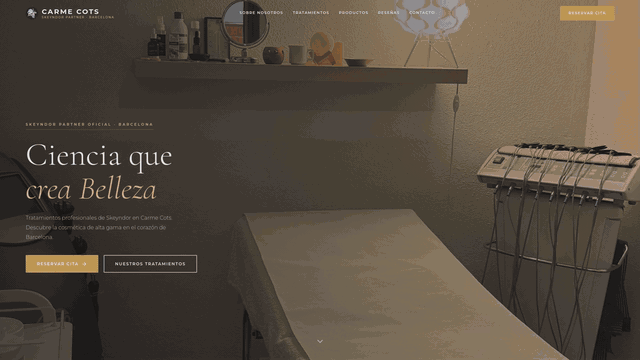
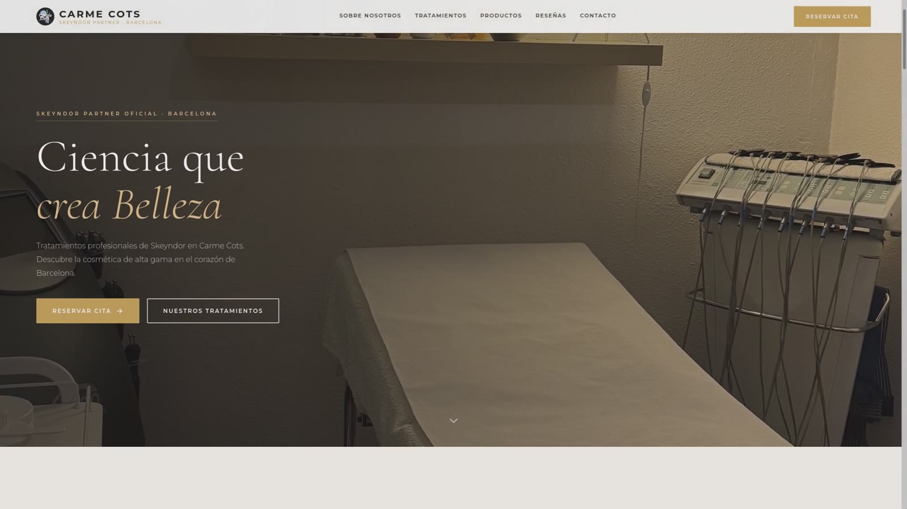
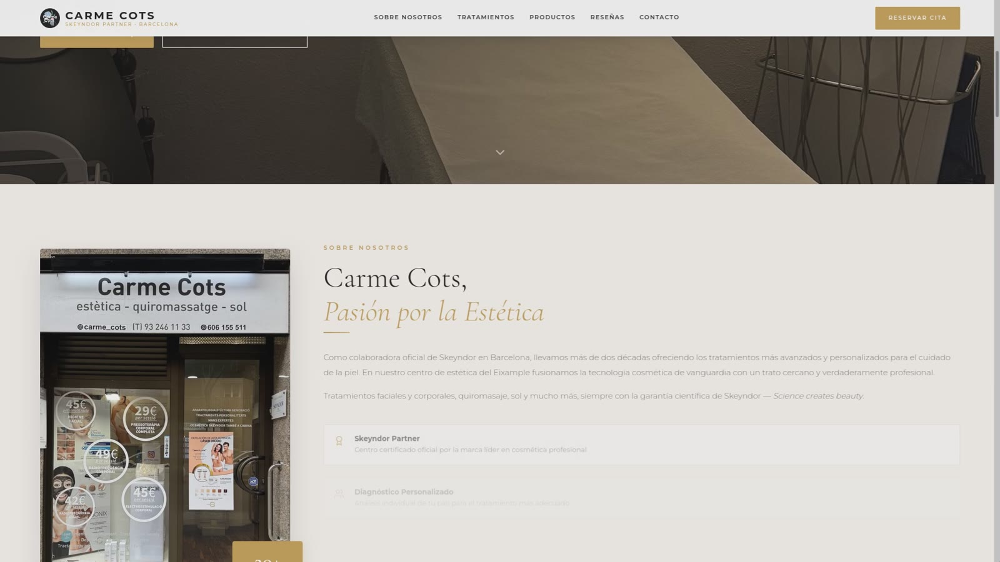
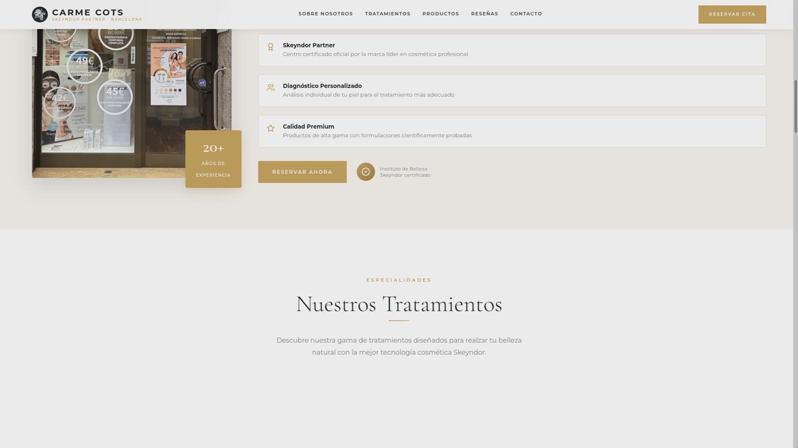
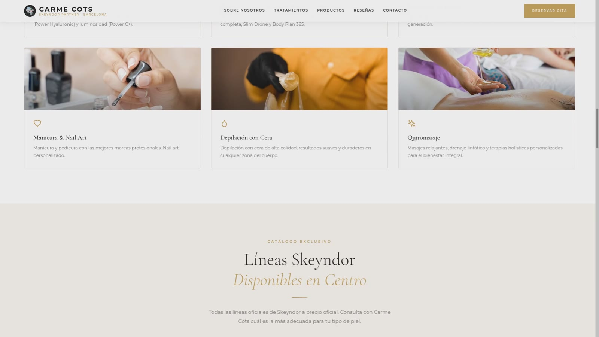

  

  
  
  
  

> **Proyecto real para un cliente:** la web de un centro de estética de Barcelona, partner oficial de la marca Skeyndor. Está en producción en **[esteticacarmecots.com](https://esteticacarmecots.com)**.

## Qué hice

- **Diseño** elegante, en tonos cálidos, pensado para transmitir confianza y calidad.
- **Desarrollo** en React + Vite, con componentes para cada sección: inicio, sobre nosotros, tratamientos, productos, reseñas y contacto.
- **Animaciones** suaves al hacer scroll con GSAP.
- **Catálogo** de tratamientos y de productos Skeyndor disponibles en el centro.
- **Reserva de cita** destacada en toda la web.
- **SEO local**, imagen para redes sociales y analítica.
- **Despliegue** continuo y dominio propio.

## Capturas

  
  
  
  

---

Desarrollado por Daniel Dans · El código fuente es privado · Todos los derechos reservados

